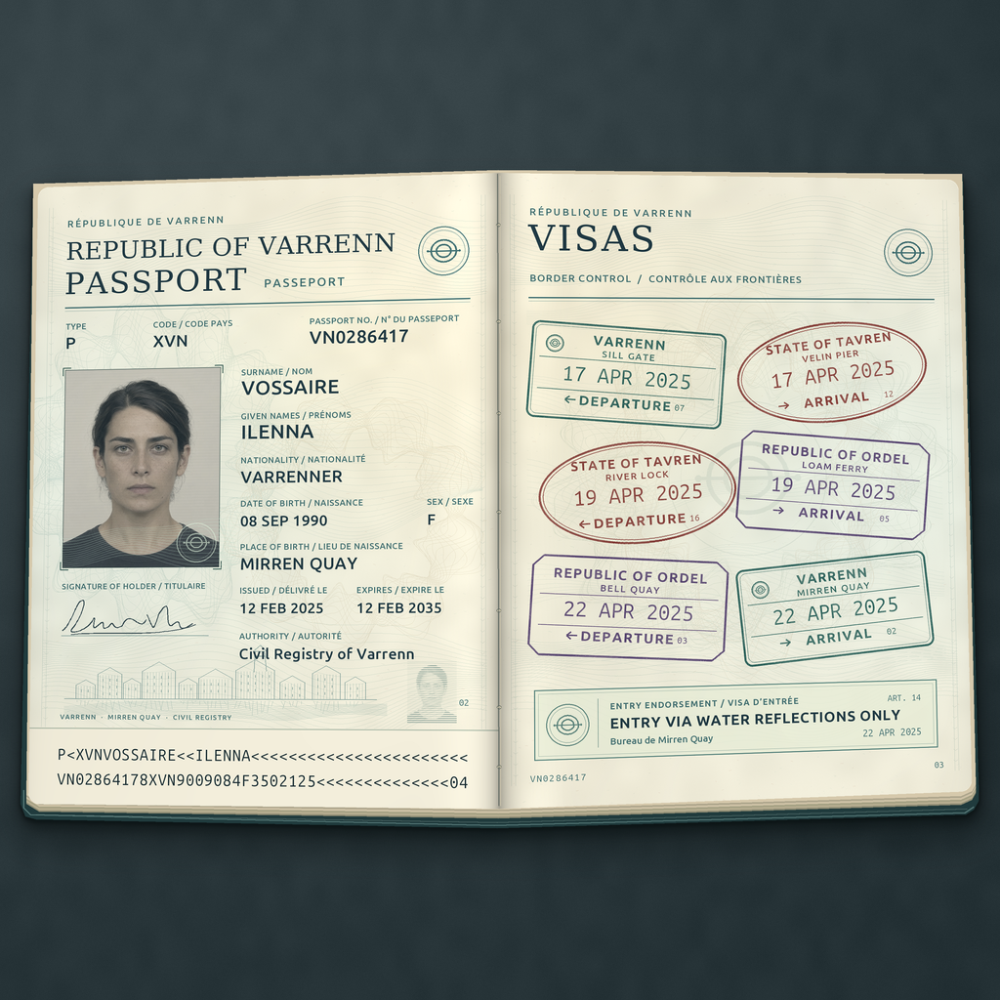

# Republic of Varrenn Passport

[](https://make.fun/bounty/the-passport-page-of-a-countr-2-20261121-0318?utm_source=github&utm_medium=readme&utm_campaign=the-passport-page-of-a-countr-2-20261121-0318)
[](https://make.fun/bounty/the-passport-page-of-a-countr-2-20261121-0318/leaderboard?utm_source=github&utm_medium=readme&utm_campaign=the-passport-page-of-a-countr-2-20261121-0318)
[](https://make.fun/bounty/the-passport-page-of-a-countr-2-20261121-0318?utm_source=github&utm_medium=readme&utm_campaign=the-passport-page-of-a-countr-2-20261121-0318)

The Republic of Varrenn (XVN) occupies an estuary that exists in the water’s reflection. The Civil Registry in Mirren Quay issues a bilingual English and French passport to Ilenna Vossaire, a resident of the capital. A small endorsement on her visa page states the rule for admission.



## Travel record

The Civil Registry issued the passport on 12 February 2025, with expiry on 12 February 2035. The stamps read across each date, then down the page.

| Date | Departure | Arrival |
| --- | --- | --- |
| 17 April 2025 | Varrenn · Sill Gate | Tavren · Velin Pier |
| 19 April 2025 | Tavren · River Lock | Ordel · Loam Ferry |
| 22 April 2025 | Ordel · Bell Quay | Varrenn · Mirren Quay |

## Rendering

`tools/render.py` typesets the identity and visa pages at three times the final resolution. Separate layers give the paper its fibers, estuary guilloche, mirrored-arch seal, laser-engraved ghost portrait, and uneven stamp impressions. The renderer computes the two 44-character machine-readable lines and their check digits from the identity fields. It reads the fictional portrait made with the built-in ImageGen tool, composites the paper, binding, and shadows, and saves a lossless PNG.

To regenerate the artwork on Ubuntu, install Pillow 12.2.0 and NumPy 2.4.6 and make Ubuntu Sans, Ubuntu Sans Mono, and DejaVu Serif available in their system font paths. Run `python3 tools/render.py` from this repository.

<details>
<summary>Portrait generation prompt</summary>

> Create one original fictional biometric passport portrait, for use as a small portrait inset in a handmade fictional travel document called the Republic of Varrenn. Image is only the photograph, no passport, no text, no numbers, no graphics. Straight-on 4:5 vertical head and upper shoulders study of a 34-year-old woman imagined as Ilenna Vossaire, a harbor resident of a cool northern estuary. Deep brown straight brows, steady hazel eyes, dark chestnut hair parted slightly off center and neatly tied back, a long oval face, olive-to-tan skin with subtle tiny natural freckles, natural face asymmetry and natural skin detail. Precisely frontal and centered, level shoulders, looking directly at camera, neutral closed mouth, no smile, no glamour retouching, no adornments, no glasses. Simple dark slate round-neck crew shirt. Both ears should be visible. Unmarked smooth pale warm gray background and neutral diffuse flat even document-camera lighting. At least 8 percent headroom, crown and lateral hair fully in frame, bottom crop below collarbone, face comfortably large and eye line just above center. Realistic ordinary civil registry studio photo, restrained colors, no vignette, no cinematic bokeh, no shadows on background, no text or borders.

</details>

## Run and verify

The competition runs `python3 main.py` under Python 3.13 with a writable `/output` directory. The entrypoint uses Python’s standard library and copies the committed 1024 × 1024 PNG to `/output/entry.png`. To reproduce that setup with a local Python 3.13 container image:

```sh
mkdir -p output/first output/second
for run in first second; do
  docker run --rm --network none --read-only --user "$(id -u):$(id -g)" \
    -v "$PWD:/source:ro" -v "$PWD/output/$run:/output:rw" \
    -w /source python:3.13-slim python -B main.py
done
cmp output/first/entry.png output/second/entry.png
sha256sum artwork/varrenn.png output/*/entry.png
```

To check the byte limit and fully decode the result with Pillow:

```sh
python3 - <<'PY'
from pathlib import Path
from PIL import Image

path = Path("output/first/entry.png")
assert path.stat().st_size <= 1_048_576
with Image.open(path) as image:
    assert image.format == "PNG" and image.size == (1024, 1024)
    image.verify()
with Image.open(path) as image:
    image.load()
PY
```
